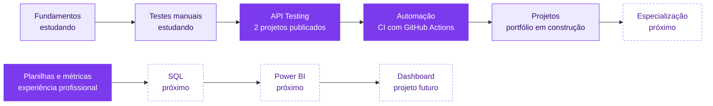

<div align="center">

<picture>
  <source media="(prefers-color-scheme: dark)" srcset="assets/header-dark.svg">
  <source media="(prefers-color-scheme: light)" srcset="assets/header-light.svg">
  
</picture>

**QA Júnior em formação** · testes de API com Postman, JavaScript e GitHub Actions · vindo de Operações Digitais

<sub>🇺🇸 Junior QA in training. Two public API testing projects with automated assertions, documented bugs and CI runs on GitHub Actions. Interested in Data/BI as a second track.</sub>

[](https://github.com/bbmoraes/qa-api-testing-postman/actions/workflows/api-tests.yml)
[](https://github.com/bbmoraes/qa-auth-api-testing/actions/workflows/api-tests.yml)

</div>

## `01` › ./projects --featured

| | Projeto | O que mostra | Resultado verificável |
|---|---|---|---|
| **01** | 🧪 [**API REST Testing**](https://github.com/bbmoraes/qa-api-testing-postman)<br><sub>JSONPlaceholder · Postman</sub> | Testes positivos, negativos, de limite e de integração · 72 verificações em JavaScript · casos de teste e bug reports | 19/21 casos aprovados · **2 defeitos reais** (500 com stack trace) · [portfólio visual](https://bbmoraes.github.io/qa-api-testing-postman/portfolio/) |
| **02** | 🔐 [**Authenticated API Testing**](https://github.com/bbmoraes/qa-auth-api-testing)<br><sub>Restful-Booker · Postman CLI · GitHub Actions</sub> | Autenticação por token · CRUD completo · Data-Driven Testing · JSON Schema · CI com etapas obrigatórias e informativas | 27/34 casos aprovados · **5 defeitos documentados** · [execuções no Actions](https://github.com/bbmoraes/qa-auth-api-testing/actions) |
| **03** | 📝 Testes manuais · *planejado* | Casos de teste, checklist e bug reports de uma aplicação web | Ainda não iniciado |
| **04** | 📊 Data Analytics & BI · *planejado* | Dashboard com SQL e Power BI | Ainda não iniciado |

**Para verificar em 1 minuto:** abra a aba **Actions** de cada projeto para ver as execuções reais, ou os bug reports ([01](https://github.com/bbmoraes/qa-api-testing-postman/tree/main/bug-reports) · [02](https://github.com/bbmoraes/qa-auth-api-testing/tree/main/bug-reports)).

## `02` › whoami

Sou a **Bianca**. Trabalho com **Social Media e Operações Digitais** e estou migrando para **Quality Assurance**, com Análise de Dados/BI como segunda trilha. Busco minha primeira vaga como **QA Júnior**, de preferência remota.

| No meu trabalho atual | O que isso vira em QA |
|---|---|
| Abro briefings e defino o que precisa ser entregue | Ler requisitos e transformar em **critérios de aceite** |
| Reviso peças antes da publicação | **Verificar uma entrega antes de liberar** |
| Acompanho demandas, prazos e gargalos | **Rastrear um problema** até a resolução |
| Monto relatórios de performance | **Ler dados** e transformar números em recomendações |

Sou formada em Direito, o que me deu o hábito de ler regras com atenção e argumentar com base em evidências. Nos meus projetos, isso aparece na forma de separar **defeito**, **limitação documentada** e **comportamento indefinido** antes de abrir um bug.

## `03` › ls ./stack

**✅ Usei em projetos publicados, com evidências**


-F7DF1E?style=for-the-badge&logo=javascript&logoColor=black)


**🧪 QA:** testes funcionais de API (positivos, negativos, de limite e de integração) · autenticação por token · CRUD · Data-Driven Testing · validação de contrato · casos de teste · bug reports com severidade e prioridade

**📊 Dados:** planilhas e análise de métricas de redes sociais (experiência profissional)

**📚 Estudando agora:** fundamentos de testes · testes manuais · Git pela linha de comando · SQL · Power BI

## `04` › cat profile.js

```javascript
const bianca = {
  role: "QA Júnior em formação",
  background: ["Operações Digitais", "Social Media", "Bacharel em Direito"],
  provenInProjects: ["Postman", "Postman CLI", "JavaScript (pm.test)", "JSON Schema", "GitHub Actions"],
  learning: ["testes manuais", "Git (CLI)", "SQL", "Power BI"],
  lookingFor: "primeira vaga como QA Júnior (remota)",
};
```

## `05` › git log --journey



<sub>Roxo cheio: entrega publicada ou experiência real · lilás: em estudo · tracejado: próximos passos. Sem percentuais: só entra aqui o que dá para comprovar.</sub>

## `06` › ping bianca

- **GitHub:** [@bbmoraes](https://github.com/bbmoraes)
- **Portfólio visual:** [bbmoraes.github.io/qa-api-testing-postman/portfolio](https://bbmoraes.github.io/qa-api-testing-postman/portfolio/)
- **E-mail:** disponível na barra lateral deste perfil

Aberta a conversas sobre QA, dados e transição de carreira.

---

```javascript
pm.test("evoluir um pouco a cada entrega", () => {
  pm.expect(hoje).to.be.above(ontem);
});
```
