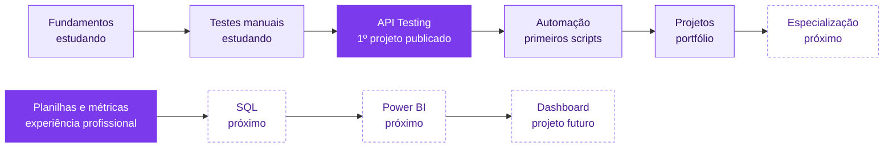

<div align="center">

<picture>
  <source media="(prefers-color-scheme: dark)" srcset="assets/header-dark.svg">
  <source media="(prefers-color-scheme: light)" srcset="assets/header-light.svg">
  
</picture>

[](https://github.com/bbmoraes/qa-api-testing-postman)
[](https://bbmoraes.github.io/qa-api-testing-postman/portfolio/)


</div>

## `01` › whoami

Sou a **Bianca**. Trabalho com **Social Media e Operações Digitais** e estou migrando para tecnologia, com foco em **Quality Assurance** e **Análise de Dados/BI**.

Na rotina de operação, eu já faço tarefas que conversam diretamente com QA e Dados:

| No meu trabalho atual | Como isso se conecta à tecnologia |
|---|---|
| Abro briefings e defino o que precisa ser entregue | Ler requisitos e transformar em **critérios de aceite** |
| Reviso peças antes da publicação | **Verificar uma entrega antes de liberar**, a mesma lógica de um teste |
| Acompanho demandas, prazos e gargalos | **Rastrear problemas** até a resolução |
| Monto relatórios de performance com métricas | **Ler dados** e transformar números em recomendações |

Também sou formada em Direito, o que me deu o hábito de ler regras com atenção e argumentar com base em evidências. Hoje estudo testes de software e já publiquei meu primeiro projeto prático de testes de API.

## `02` › cat profile.js

```javascript
const bianca = {
  role: "QA & Data Analytics — em formação",
  background: [
    "Social Media",
    "Operações Digitais",
    "Bacharel em Direito",
  ],

  // já usei em um projeto publicado
  usedInProjects: [
    "Postman + Collection Runner",
    "JavaScript (pm.test + Chai)",
    "APIs REST",
    "Markdown",
    "GitHub",
  ],

  // estudando agora
  currentlyLearning: [
    "Fundamentos de testes",
    "Testes manuais",
    "Automação de testes de API",
  ],

  // próximos passos da trilha de dados
  nextUp: ["SQL", "Power BI"],

  strengths: [
    "atenção a detalhes",
    "organização de processos",
    "documentação",
    "leitura de métricas",
  ],

  lookingFor: "QA Júnior ou Analista de Dados/BI Júnior",
};
```

## `03` › ls ./stack

**✅ Já usei em projeto publicado**


-F7DF1E?style=for-the-badge&logo=javascript&logoColor=black)


**🧪 QA & Testing**: testes funcionais (positivos, negativos, de limite e de integração) · casos de teste · bug reports · evidências de execução

**📊 Data & Analytics**: planilhas e análise de métricas de redes sociais (experiência profissional)

**📚 Em estudo / próximos passos**


-estudando-8B5CF6?style=flat-square&logo=git&logoColor=white)


## `04` › ./projects --featured

### 🧪 [QA · API Testing with Postman](https://github.com/bbmoraes/qa-api-testing-postman)

Projeto de estudos com testes funcionais de uma API REST pública (JSONPlaceholder), **executados de verdade** no Postman e documentados como em um time de QA.

| | |
|---|---|
| **O que fiz** | Planejei 21 casos de teste, automatizei 72 verificações em JavaScript, executei a collection no Collection Runner, investiguei as falhas e documentei bugs e evidências |
| **Resultado** | 19 de 21 casos aprovados · **2 defeitos reais encontrados** (respostas 500 com stack trace onde o esperado era 4xx) |
| **Tecnologias** | Postman · JavaScript (`pm.test`/Chai) · API REST · CSV/XLSX · Markdown |
| **Links** | [Repositório](https://github.com/bbmoraes/qa-api-testing-postman) · [Portfólio visual](https://bbmoraes.github.io/qa-api-testing-postman/portfolio/) · [Bug reports](https://github.com/bbmoraes/qa-api-testing-postman/tree/main/bug-reports) |

### 📊 Projeto de Dados/BI · *em planejamento*

> Espaço reservado para o meu primeiro dashboard de dados (SQL + Power BI). Ainda não foi iniciado. Ele só vai aparecer aqui quando estiver publicado, com dados e fonte verificáveis.

## `05` › git log --journey



<sub>Roxo cheio: etapa com entrega publicada ou experiência real · lilás: em estudo · tracejado: próximos passos. Sem percentuais: o que está aqui é o que dá para comprovar.</sub>

## `06` › ping bianca

[](https://github.com/bbmoraes)
[](https://bbmoraes.github.io/qa-api-testing-postman/portfolio/)

Aberta a conversas sobre QA, dados e transição de carreira.

---

```javascript
pm.test("evoluir um pouco a cada entrega", () => {
  pm.expect(hoje).to.be.above(ontem);
});
```
